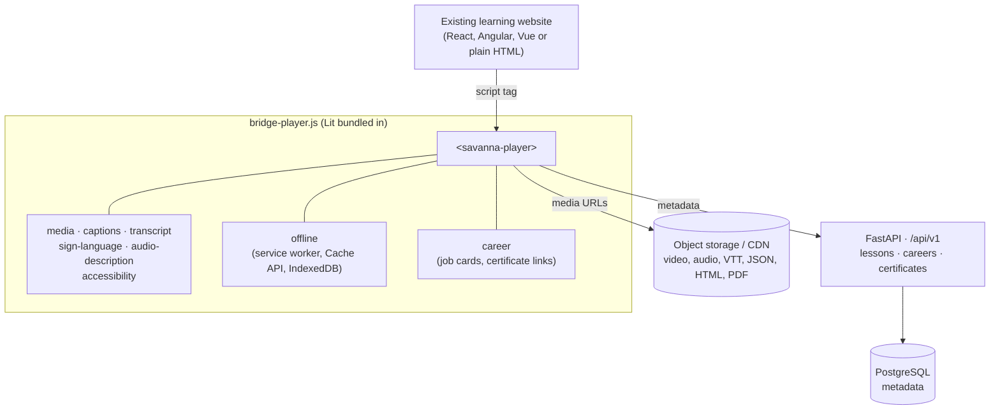

# Savanna BridgePlayer

**Accessible learning, dropped into any website with one script tag.**

Savanna BridgePlayer is an embeddable plugin that adds accessible video, English and Amharic
captions, Ethiopian Sign Language interpretation, audio description, synchronized transcripts,
offline lessons, accessible documents and career cards to **existing** learning websites. The host
site keeps its own stack; the plugin is a single Web Component.

```html
<script src="https://cdn.example.com/bridge-player.js" defer></script>
<savanna-player lesson-id="networking-101" api-base="https://api.example.com"></savanna-player>
```

[Architecture](#architecture) · [Getting started](#getting-started) · [Accessibility](#accessibility) ·
[Documentation](#documentation)

## Features

| Area               | What learners get                                                             |
| ------------------ | ----------------------------------------------------------------------------- |
| Video controls     | Native buttons and sliders, full keyboard use, shortcuts that never fire while typing |
| Captions           | English and Amharic, adjustable size and colors, high-contrast mode           |
| Sign language      | Ethiopian Sign Language window that can be shown, moved and resized by keyboard or pointer |
| Audio description  | Optional prerecorded description track kept in sync with the lesson           |
| Transcript         | Follows playback, click or Enter on a sentence to seek, search, bookmarks, download |
| Offline            | Download audio, text or everything; works after disconnecting                 |
| Documents          | Lesson notes as accessible HTML and a tagged PDF                              |
| Career gateway     | Job cards with audio summaries, accommodations, filters and certificate verification |

## Accessibility

The target is WCAG 2.2 AA. Automated checks do not prove that, so the project keeps both kinds of
evidence:

- **Automated:** `eslint-plugin-lit-a11y` on every template, unit tests for roles and keyboard
  behaviour, and Playwright with axe-core on the full player. The build fails on any critical or
  serious violation.
- **Manual:** keyboard, NVDA, TalkBack, 200% zoom, sound off and offline sessions are recorded in
  [`manual-test-record.md`](docs/testing/manual-test-record.md), including failures and known
  limitations. The latest full session is prepared but not yet run, and the record says so.

Lesson media (video, captions, sign-language interpretation, audio description) must be prepared and
reviewed by people. None of it is generated automatically, and the repository does not contain the
large media files; see [`assets/README.md`](assets/README.md).

## Architecture



The API returns **metadata and URLs**; browsers fetch media straight from storage. See
[`docs/architecture.md`](docs/architecture.md).

## Repository layout

```
apps/
  api/            FastAPI service (routes → services → repositories → models), Alembic, Dockerfile
  demo/           Sample host website + Playwright/axe-core e2e tests (not a learning platform)
packages/
  contracts/      Shared API types generated from OpenAPI + <savanna-player> element contract
  player/         <savanna-player> Web Component; builds the embeddable bundle
  offline/        Service worker, download manager, IndexedDB storage
  career/         <savanna-job-card>, <savanna-certificate-link>
assets/           Lesson media conventions (large files live in object storage, not git)
docs/             Installation, integration, API, architecture, accessibility and test docs
infra/            Local media server config
.github/          CI and CD workflows, Dependabot, PR template
```

## Getting started

Requirements: Node 24 (`.nvmrc`), pnpm 11, [uv](https://docs.astral.sh/uv/), Docker.

```bash
pnpm install
(cd apps/api && uv sync && cp .env.example .env)

docker compose up -d db media   # PostgreSQL on :5432, media on :8080
pnpm api:dev                    # API on :8000, docs at /docs
pnpm dev                        # builds the plugin, demo on :5173
```

Full instructions: [`docs/installation.md`](docs/installation.md).

## Common commands

| Command                                    | What it does                                        |
| ------------------------------------------ | --------------------------------------------------- |
| `pnpm build`                               | Build plugin bundle, service worker and demo        |
| `pnpm lint` / `pnpm typecheck`             | ESLint (incl. lit-a11y) / TypeScript                |
| `pnpm test` / `pnpm test:coverage`         | Vitest unit tests for all packages                  |
| `pnpm test:e2e`                            | Playwright + axe-core against the demo (build first)|
| `pnpm api:lint` / `pnpm api:test`          | Ruff + mypy / pytest for the API                    |
| `pnpm api:openapi && pnpm contracts:generate` | Regenerate the shared TypeScript contract        |

## CI/CD

- **CI** (`.github/workflows/ci.yml`, every pull request): web lint/typecheck/unit tests/build,
  Playwright + axe-core e2e, API lint/mypy/unit + PostgreSQL integration tests + migrations,
  OpenAPI ↔ TypeScript contract drift check, API Docker build.
- **CD** (`.github/workflows/cd.yml`, push to `main` and `v*` tags): runs CI, then publishes the
  API image to GHCR, attaches the plugin bundle to GitHub Releases on tags, and (opt-in via
  `DEPLOY_DEMO_PAGES=true`) deploys the demo site to GitHub Pages.

## Documentation

- [Architecture](docs/architecture.md) · [ADR 0001](docs/adr/0001-embeddable-plugin.md)
- [Installation](docs/installation.md) · [Integration](docs/integration.md) · [API](docs/api.md)
- [Accessibility testing](docs/accessibility-testing.md)
- Testing: [strategy](docs/testing/test-strategy.md) ·
  [acceptance checklist](docs/testing/acceptance-checklist.md) ·
  [manual test record](docs/testing/manual-test-record.md)
- [Contributing](CONTRIBUTING.md)

## Scope

We are building one embeddable plugin, one supporting REST API, one sample host page and one
prepared demonstration lesson. We are **not** building an LMS, a content-management dashboard, a
job marketplace, automatic sign-language generation, or production ASR/translation.
